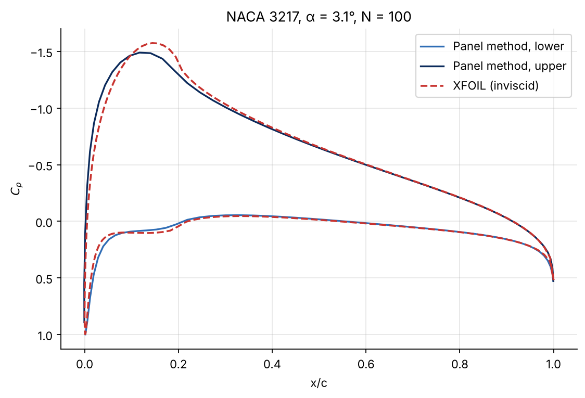
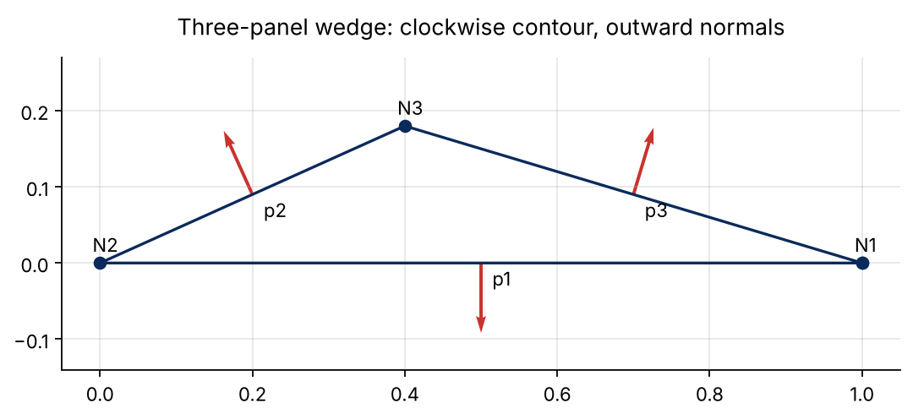
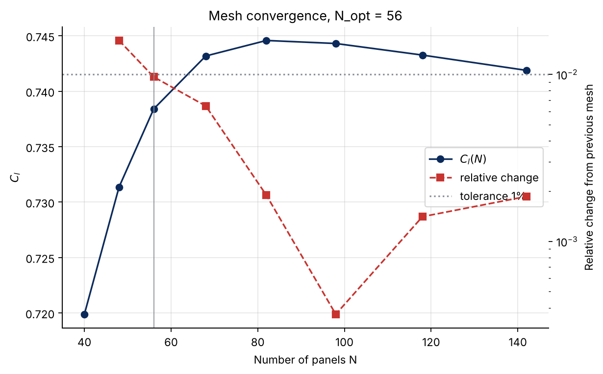
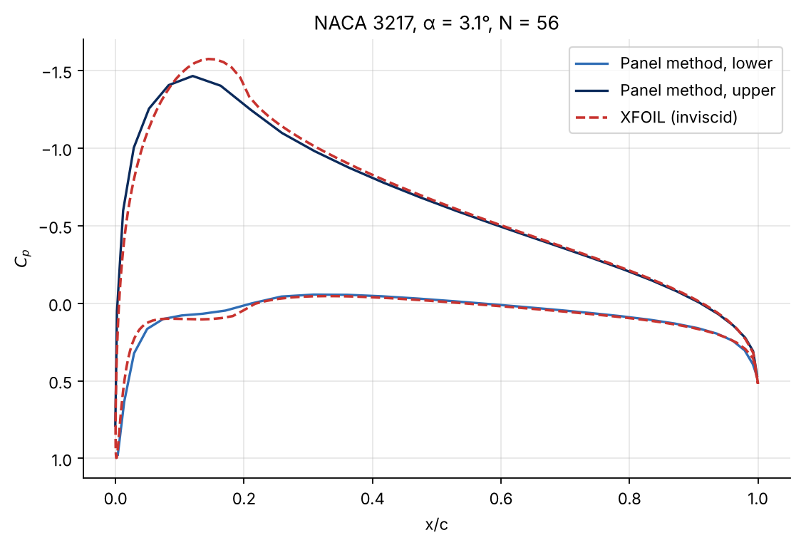
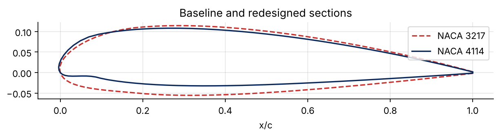
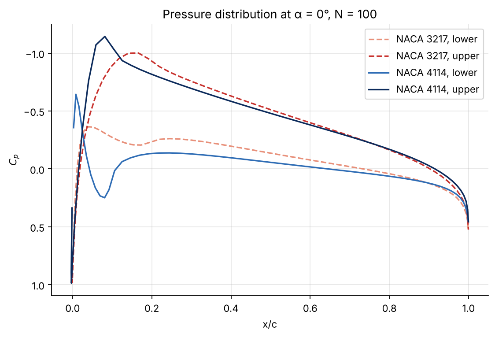
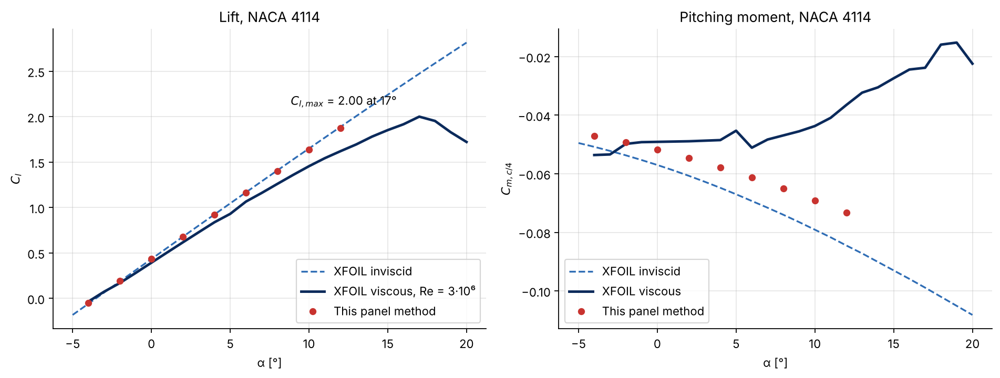

# Panel method and inverse design of NACA airfoils

[](https://github.com/CPesquero/panel-method-airfoil-design/actions/workflows/ci.yml)
[](https://www.python.org/downloads/)
[](LICENSE)
[](https://colab.research.google.com/github/CPesquero/panel-method-airfoil-design/blob/main/notebooks/panel_method_analysis.ipynb)

**2D potential-flow analysis of NACA 4-digit airfoils, validated against XFOIL, and a redesign for +20 % lift.**

A from-scratch Python implementation of a source-and-vortex panel method (Hess–Smith type). It builds NACA 4-digit sections, solves for the source strengths and the circulation with the Kutta condition, and returns the pressure distribution, lift and pitching moment. The study validates it against XFOIL, picks the mesh with a convergence study, searches the NACA 4-digit family for a section with 20 % more lift at zero incidence, and compares that section with viscous XFOIL results.



| | Result |
|---|---|
| Hand calculation (3-panel wedge, α = 3.1°) | γ = 0.211, C<sub>l</sub> = 0.873 |
| NACA 3217, α = 3.1°, N = 100 | C<sub>l</sub> = 0.7442 (XFOIL 0.7373, +0.9 %); C<sub>m,c/4</sub> = −0.0598 (XFOIL −0.0644) |
| Mesh convergence | N<sub>opt</sub> = 56 (first mesh changing C<sub>l</sub> by < 1 %) |
| NACA 3217, N = 56 | C<sub>l</sub> = 0.7384 (+0.15 % vs XFOIL); C<sub>m,c/4</sub> = −0.0584 |
| Inverse design, α = 0° | NACA 3217 → **NACA 4114**: C<sub>l</sub> 0.354 → 0.436 (+23 %), C<sub>m,c/4</sub> −0.0520 → −0.0518 (0.3 % change) |
| NACA 4114 vs XFOIL inviscid, α = 0° | C<sub>l</sub> 0.4355 vs 0.4332 (0.5 %) |
| NACA 4114, XFOIL viscous, Re = 3·10⁶ | C<sub>l,max</sub> = 2.00 at α = 17° |

Every number is produced by `panelfoil` (see [Reproducing the results](#reproducing-the-results)) and checked by the test suite. They match the revised report in [`docs/`](docs/); see [Corrections to the original analysis](#corrections-to-the-original-analysis) for what changed from the first edition.

## Quick start

```bash
git clone https://github.com/CPesquero/panel-method-airfoil-design.git
cd panel-method-airfoil-design
pip install -e .        # or: pip install -e ".[dev]" for tests and linting
panelfoil               # prints every table and writes all figures to ./figures
```

Use it as a library:

```python
import panelfoil as pf

af = pf.Naca4.from_code("2412")
X, Y = af.coordinates(n_panels=100)       # clockwise from the trailing edge
sol = pf.solve(X, Y, alpha_deg=4.0)

sol.cl          # lift (Kutta-Joukowski, from the circulation)
sol.cl_pressure # lift from integrating the pressures (cross-check)
sol.cm_c4       # pitching moment about c/4, positive nose-up
sol.cp          # pressure coefficient at the panel midpoints
```

The walkthrough notebook [`notebooks/panel_method_analysis.ipynb`](notebooks/panel_method_analysis.ipynb) runs the whole study step by step and also opens in Colab.

## The method

The contour is split into N straight panels, ordered clockwise from the trailing edge so that every normal points out of the body. Each panel carries a constant source strength q<sub>j</sub>, and all panels share one constant vortex strength γ. That gives N + 1 unknowns:

1. **Flow tangency** at the N control points (panel midpoints): the normal velocity from the free stream plus all panels is zero.
2. **Kutta condition**: the tangential velocities on the first and last panel (the two sides of the trailing edge) are equal and opposite.

Lift follows from the circulation, C<sub>l</sub> = 2γ ΣL<sub>i</sub>. The pressure coefficient is C<sub>p</sub> = 1 − V<sub>t</sub><sup>2</sup>, and the moment about the quarter chord is integrated from the pressures.

```text
NACA f p t ──> nodes (cosine spacing) ──> influence coefficients ──> [A]{q, γ} = {I}
                                                                          │
                              V_t, C_p, C_l (circulation), C_m,c/4 (pressures)
                                                                          │
              XFOIL comparison · mesh study · NACA 4-digit search for +20 % C_l
```

## Results

### Hand calculation: three-panel wedge

The geometry comes from the assignment (ID digits X = 7, Y = 3, Z = 8): α = 3.1°, wedge vertex at (0.40, 0.18). With three panels the 4 × 4 system can be written out by hand; `pf.system()` reproduces it:



The result, γ = 0.211 and C<sub>l</sub> = 0.873, is identical to the general solver run on the same three panels.

### Validation against XFOIL (NACA 3217, α = 3.1°)

With 100 panels, lift is within 1 % of XFOIL and the pressure distributions overlap from about 40 % of the chord backwards. The largest differences are at the suction peak near the leading edge, where 100 flat panels are coarse. The moment is off by about 7 %: it weights those local errors by their lever arm.

### Mesh convergence

From 40 panels the mesh grows by 20 % per step. The first mesh that changes C<sub>l</sub> by less than 1 % is N = 56, taken as N<sub>opt</sub>.



C<sub>l</sub> does not converge monotonically: it peaks near N = 82 and drifts down slightly with finer meshes. The very small error at N = 56 (0.15 %) is therefore partly a coincidence; the honest figure for this method is about 1 %.



## Inverse design

**Goal.** At α = 0°, raise C<sub>l</sub> by 20 % over the NACA 3217 while changing C<sub>m,c/4</sub> as little as possible.

**Search.** Every NACA 4-digit section with f = 1–9 %, p = 10–60 % and t = 5–25 % (1 134 sections, about half a second). Sections whose C<sub>l</sub> lies within 0.015 of the target (0.4250) are kept; the one with the smallest change in moment wins.

**Result.** 29 sections meet the lift target. The best is the **NACA 4114**: one point more camber (3 → 4 %), maximum camber moved forward (20 → 10 % of the chord) and 3 points less thickness (17 → 14 %). C<sub>l</sub> rises 23 % and the moment changes by 0.3 %.



More camber raises the circulation; moving it forward keeps the extra load ahead of the quarter chord, so the nose-down moment does not grow. The suction peak moves forward with it:



## Viscous effects (XFOIL, NACA 4114)

The panel method (red markers) stays within 0.013 of XFOIL's inviscid lift over the range computed (−4° to 12°). With viscosity (Re = 3·10⁶) the slope drops and the section stalls at C<sub>l,max</sub> = 2.00, α = 17°. The viscous moment is less nose-down than the inviscid one and becomes non-linear near stall.



## Corrections to the original analysis

Refactoring the Colab notebook into a tested package exposed several problems in the original code and report. They are fixed here and in the revised edition of the report (October 2026):

1. **Sign of the pitching moment.** The original formula had an extra minus sign, so C<sub>m,c/4</sub> came out positive (+0.0598). A cambered section has a nose-down moment: with outward normals and nose-up positive, it is −0.0598, the same sign as XFOIL (whose own polar shows negative values). Magnitudes and relative errors do not change.
2. **Hand calculation of the wedge.** Panel 1 had its normal pointing into the body, and the Kutta equation dropped the free-stream terms (I<sub>4</sub> = 0). With a consistent clockwise contour the result is γ = 0.211 and C<sub>l</sub> = 0.873 (not 0.174 and 0.718), and it now matches the code exactly.
3. **Typos in the equations**: the velocity projections (eqs. 9–12) used u\* where w\* belongs and q<sub>j</sub> instead of γ for the vortex terms; eq. 15 had a wrong sign; the sum in eq. 17 ran over i instead of j.
4. **Statements**: the NACA 3217 has its maximum camber at 20 % of the chord (not 2 %); the redesign adds one point of camber (not two); the viscous section analysed in XFOIL is the NACA 4114 (the text said 4117); its C<sub>l,max</sub> is at 17° (not 16°); the 0.15 % lift error at N = 56 is partly fortuitous (see above).

Also fixed: the notebook depended on files in Google Drive. The XFOIL outputs now ship with the package in `src/panelfoil/data/`.

## Limitations

- **Inviscid, attached flow.** No boundary layer, so no drag and no stall: the panel method's C<sub>l</sub>–α is linear by construction.
- **Moment accuracy is about 10 %**, an order of magnitude worse than lift, and the gap grows with α for the NACA 4114 (−0.073 vs −0.085 at 12°).
- **Constant-strength panels and an open trailing edge.** The NACA thickness law leaves a small gap at the trailing edge, and the solution near the leading edge needs fine panels.
- **The inverse design is a brute-force grid** over integer NACA digits with an absolute lift tolerance; it does not look at stall, drag or structural thickness.
- **XFOIL is a reference, not the truth**: it is itself a panel method with a viscous boundary-layer model.

## Reproducing the results

```bash
pip install -e ".[dev]"
make test       # report values, physics checks, equivalence with the original loop solver
make lint       # ruff
make figures    # regenerates figures/*.png and results/results.json
```

`panelfoil --help` lists the options (`--no-figures`, `--json`, `--figures-dir`). GitHub Actions runs the linter, the tests on Python 3.9–3.13, the command-line reproduction and the notebook on every push.

## Project structure

```text
src/panelfoil/
  geometry.py   NACA 4-digit sections, the hand-calculation wedge, BASELINE / OPTIMIZED
  solver.py     influence coefficients (vectorized), solve(), system(), Cl, Cp, Cm
  studies.py    mesh convergence and inverse design
  xfoil.py      readers for the XFOIL reference files
  plots.py      every figure in the README
  cli.py        the `panelfoil` command
  data/         XFOIL outputs (Cp of NACA 3217; inviscid and viscous polars of NACA 4114)
tests/          test suite
notebooks/      step-by-step walkthrough (opens in Colab)
figures/        generated figures
results/        generated numbers (JSON)
docs/           revised report (PDF and Word)
```

## Documentation

| Document | What it is |
|---|---|
| [`docs/panel_method_report.pdf`](docs/panel_method_report.pdf) | The report (revised edition): derivation, hand calculation, validation, design and conclusions |
| [`docs/panel_method_report.docx`](docs/panel_method_report.docx) | The same report in Word |
| [`notebooks/panel_method_analysis.ipynb`](notebooks/panel_method_analysis.ipynb) | Walkthrough of the study with the package |
| [`CHANGELOG.md`](CHANGELOG.md) | What changed from the original notebook |

## References

1. R. Sant and L. Ayuso, *Trabajo de diseño de perfiles: guion*, Universidad Politécnica de Madrid.
2. J. L. Hess and A. M. O. Smith, "Calculation of potential flow about arbitrary bodies", *Progress in Aerospace Sciences*, 8, 1967.
3. J. J. Bertin and R. M. Cummings, *Aerodynamics for Engineers*, Pearson.
4. M. Drela, *XFOIL: An analysis and design system for low Reynolds number airfoils*, 1989.

AI assistance (Gemini) was used for parts of the original code, as declared in the report.

## Authors

Lucas García Franco and Carlos Pesquero Cañizares. Universidad Politécnica de Madrid, ETSIAE.

If you use this code, please cite it (see [`CITATION.cff`](CITATION.cff)).
